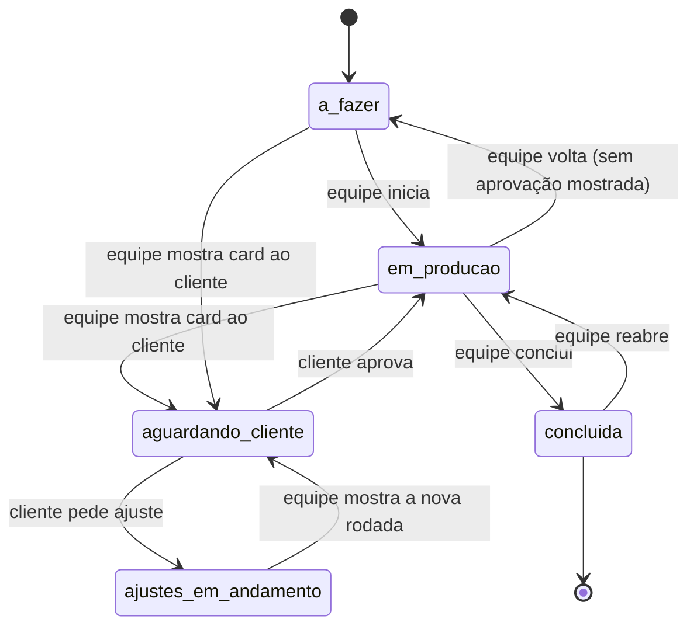
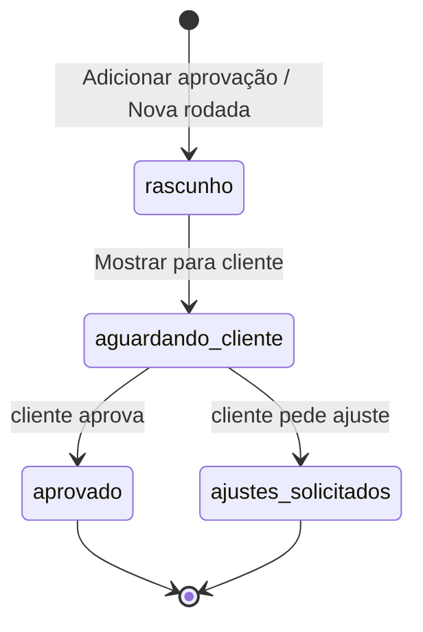

# 02 · Fluxos e estados

Toda mudança de estado passa por uma classe de ação em `app/Acoes/` que confere se a transição é
permitida (tabelas abaixo), grava a `Atividade` e dispara os avisos. Transição fora da tabela = erro.

## Estados de uma fase (14/10/2026)

Nas telas: fase. No código: `Etapa`. Fluxo completo da equipe em [`14-fluxo-equipe.md`](14-fluxo-equipe.md).

| Estado (`EstadoEtapa`) | A equipe vê |
|---|---|
| `a_fazer` | A fazer |
| `em_producao` | Em andamento |
| `aguardando_cliente` | Aguardando cliente (prazo DD/MM) |
| `ajustes_em_andamento` | Ajustes |
| `concluida` | Concluída |

| De | Para | Quem | Ação (`app/Acoes`) | Efeitos |
|---|---|---|---|---|
| `a_fazer` | `em_producao` | Equipe | `IniciarEtapa` | — |
| `a_fazer` / `em_producao` / `ajustes_em_andamento` | `aguardando_cliente` | Equipe | `PublicarEntrega` | Card publicado e bloqueado; prazo de 5 dias úteis; e-mail ao e-mail de avisos (RN-72, RN-73) |
| `aguardando_cliente` | `em_producao` | Cliente | `AprovarEntrega` | Cria `Aprovacao` (hash); e-mail à equipe (RN-76) |
| `aguardando_cliente` | `ajustes_em_andamento` | Cliente | `PedirAjuste` | Card "Ajustes solicitados"; e-mail à equipe (RN-76) |
| `em_producao` | `concluida` | Equipe | `ConcluirEtapa` | Só sem card aberto |
| `concluida` | `em_producao` | Equipe | `ReabrirEtapa` | Confirmação; histórico `etapa.reaberta` (RN-14a) |
| `em_producao` | `a_fazer` | Equipe | `VoltarEtapaParaAFazer` | Só se nenhum card da fase foi mostrado ao cliente; confirmação; histórico `etapa.voltou_a_fazer` (RN-14a) |

Enquanto a fase está em `aguardando_cliente`, não dá para concluí-la nem abrir outro card.

## Estados de um card de aprovação

| Situação (`SituacaoCard`) | Quando | Pode editar? |
|---|---|---|
| `rascunho` | Adicionar aprovação / Nova rodada | Sim; pode excluir |
| `aguardando_cliente` | Mostrar para cliente | Não; só o prazo |
| `aprovado` | Cliente aprovou | Não |
| `ajustes_solicitados` | Cliente pediu ajuste | Não; a equipe cria a próxima rodada |

Tarefas automáticas (agendador, uma vez por card): `EnviarLembretePrazo` 1 dia útil antes do
vencimento (RN-74) e `AlertarPrazoVencido` no dia seguinte ao vencimento (RN-75). Card já respondido
é ignorado.

## Fluxo: do cadastro ao primeiro card

1. Equipe cadastra o cliente com o e-mail de avisos (RN-06) e anexa o contrato se quiser (RN-07).
2. Na ficha, **Cadastrar serviço** → escolhe o serviço e a data de início → fases do fluxo padrão carregadas (RN-10, RN-13).
3. Equipe ajusta as fases: responsável, o que fazer, entrada e término (RN-12).
4. Numa fase, **Adicionar aprovação** → card em rascunho (RN-70).
5. **Mostrar para cliente** → card bloqueado, prazo, fase "Aguardando cliente", e-mail ao cliente (RN-72).
6. Véspera do prazo: lembrete ao cliente; vencido: alerta à equipe (RN-74, RN-75).
7. Resposta do cliente → fase segue ou **Nova rodada** (RN-76).

O acesso do cliente (convite, criar senha, boas-vindas) segue RN-02 e RN-03 e será revisto na fase do
login do cliente.

## Fases antigas: pendência, entrega final e recorrente

As regras abaixo continuam como referência para as fases futuras e serão revistas quando chegar a vez delas.

| Tipo | Fluxo |
|---|---|
| `pendencia_cliente` | `a_fazer` → `aguardando_cliente` (equipe libera) → `recebida` (cliente envia) → `concluida` ou de volta (pedir complemento) |
| `entrega_final` | `a_fazer` → `em_producao` → `concluida` (com arquivos). Aparece em "Arquivos" do cliente |
| `recorrente` | Fica `em_producao`; a equipe publica um item por mês (ex.: relatório) |

## Fluxo: pedir ajuste

1. No card aguardando resposta, o cliente toca em **"Solicitar ajustes"**.
2. Escreve o que quer ajustar e anexa imagens, se quiser; o texto fica salvo como rascunho (RN-21a).
3. Envia → `PedirAjuste` em transação com trava no serviço e na fase → card "Ajustes solicitados" e
   fase em `ajustes_em_andamento`; a equipe recebe o aviso (RN-76).
4. Na versão final não há "Solicitar ajustes": o cliente só autoriza (RN-71).

## Fluxo: concluir e arquivar

1. Todas as etapas aprovadas/concluídas → equipe clica "Concluir serviço" (RN-60).
2. 30 dias depois → aviso no painel e por e-mail à equipe (RN-61).
3. Equipe clica "Arquivar e remover" → o portal monta o pacote (ZIP + PDF do histórico) em fila → aviso "pacote pronto".
4. Equipe baixa o pacote, guarda no computador, volta e confirma digitando o nome do cliente (RN-63).
5. O portal apaga os dados da frente e o pacote do servidor; grava a linha mínima de arquivamento.
