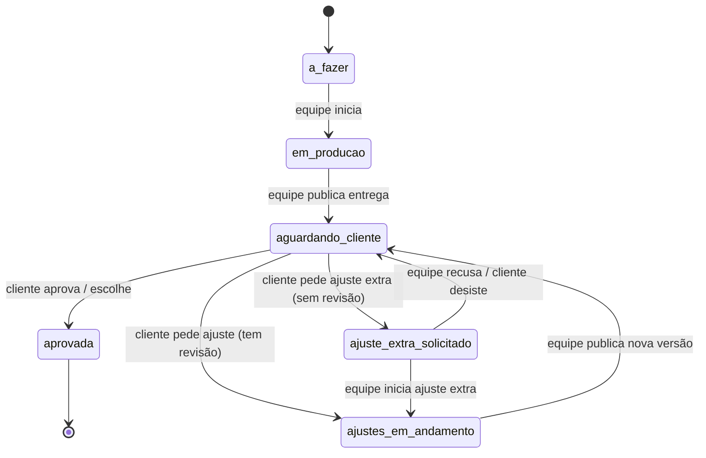
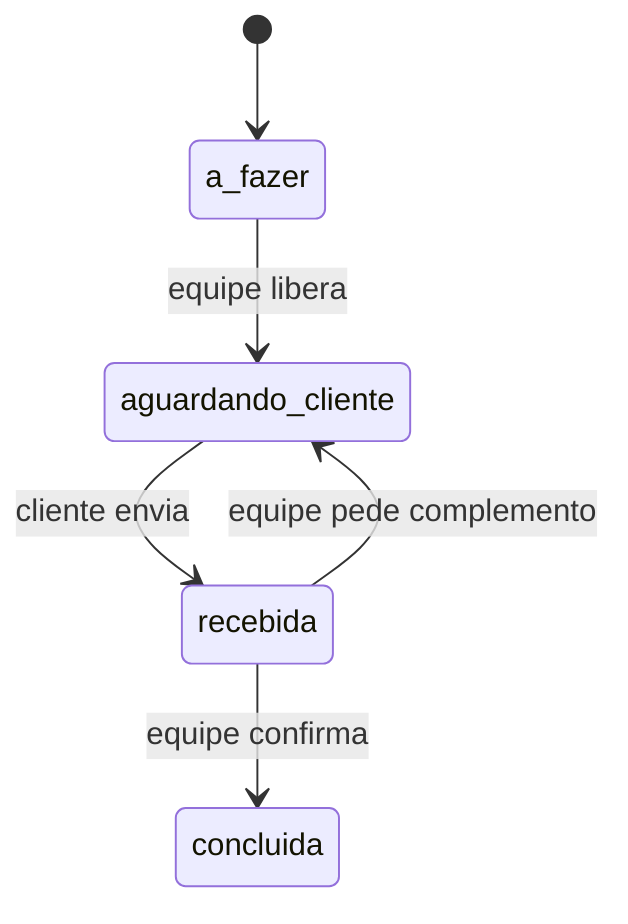

# 02 · Fluxos e estados

Toda mudança de estado passa por uma classe de ação em `app/Acoes/` que confere se a transição é
permitida (tabelas abaixo), grava a `Atividade` e dispara os avisos. Transição fora da tabela = erro.

## Estados de uma etapa

| Estado (`EstadoEtapa`) | O cliente vê | A equipe vê |
|---|---|---|
| `a_fazer` | Próxima (cinza) | A fazer |
| `em_producao` | Em produção pela Dobra 9 | Em produção |
| `aguardando_cliente` | **Precisa de você** | Esperando cliente (N dias úteis) |
| `recebida` | Recebido, obrigado | Material recebido: conferir |
| `ajustes_em_andamento` | Ajustes em andamento | Ajustes pedidos: fazer |
| `ajuste_extra_solicitado` | Ajuste extra solicitado: aguardando orçamento | Orçar ajuste extra |
| `aprovada` | Aprovada em DD/MM | Aprovada |
| `concluida` | Concluída | Concluída |

## Etapa de aprovação (`aprovacao`) e de escolha (`escolha`)

| De | Para | Quem | Ação (`app/Acoes`) | Efeitos |
|---|---|---|---|---|
| `a_fazer` | `em_producao` | Equipe | `IniciarEtapa` | — |
| `em_producao` | `aguardando_cliente` | Equipe | `PublicarEntrega` | Cria `Entrega` v1; e-mail ao cliente; começa prazo de 3 dias úteis |
| `aguardando_cliente` | `aprovada` | Cliente | `AprovarEntrega` / `EscolherOpcao` | Cria `Aprovacao` (hash); e-mail à equipe |
| `aguardando_cliente` | `ajustes_em_andamento` | Cliente | `PedirAjuste` | Cria `PedidoAjuste`; gasta revisão se `gasta_revisao`; e-mail à equipe |
| `aguardando_cliente` | `ajuste_extra_solicitado` | Cliente | `SolicitarAjusteExtra` | Cria `PedidoAjuste` tipo `extra`; e-mail à equipe para orçar |
| `ajuste_extra_solicitado` | `ajustes_em_andamento` | Equipe | `IniciarAjusteExtra` | — |
| `ajuste_extra_solicitado` | `aguardando_cliente` | Equipe | `CancelarAjusteExtra` | Pedido marcado como cancelado |
| `ajustes_em_andamento` | `aguardando_cliente` | Equipe | `PublicarEntrega` | Cria `Entrega` vN+1; e-mail ao cliente; reinicia prazo |

Em qualquer momento, sobre um `PedidoAjuste` do tipo `revisao`, a equipe pode `MarcarCorrecaoNossa`:
o pedido deixa de contar (RN-24), sem mudar o estado da etapa.

## Pendência do cliente (`pendencia_cliente`)

Pendências não gastam revisão. "Pedir complemento" leva uma mensagem da equipe ao cliente.
O briefing do Rebranding é uma pendência com formulário (perguntas em `dados/briefing-rebranding.yaml`).

## Trabalho da equipe (`trabalho_equipe`), entrega final e recorrente

| Tipo | Fluxo |
|---|---|
| `trabalho_equipe` | `a_fazer` → `em_producao` → `concluida`. Ao concluir, a equipe pode escrever um aviso que o cliente vê |
| `entrega_final` | `a_fazer` → `em_producao` → `concluida` (com arquivos). Aparece em "Arquivos" do cliente |
| `recorrente` | Fica `em_producao`; a equipe publica um item por mês (ex.: relatório), que aparece na linha do tempo e em "Arquivos" |

## Fluxo: do cadastro ao primeiro acesso

1. Equipe cadastra o cliente (RN-06), anexa o contrato se quiser (RN-07).
2. Equipe clica em "Adicionar serviço", escolhe o modelo, data de início e prazo → etapas criadas com datas (RN-11, RN-13).
3. Equipe revisa e ajusta as etapas.
4. Equipe clica em **"Enviar acesso"** → e-mail com link de 72 h (RN-02, RN-03).
5. Cliente cria a senha → vê a tela de boas-vindas com as regras (3 dias úteis, 3 revisões, o que conta) → Início.

## Fluxo: pedir ajuste

1. Na etapa `aguardando_cliente`, o cliente toca em **"Pedir ajuste"**.
2. Escreve os itens (um campo por item, "+ adicionar item") e anexa referências, se quiser.
3. Tela de confirmação: "Você vai usar a revisão 2 de 3 do Rebranding…" (RN-22, RN-26).
4. Confirma → `PedirAjuste` em transação com trava na frente (RN-29) → etapa em `ajustes_em_andamento`.
5. Sem revisões → o botão já aparece como "Solicitar ajuste extra" (RN-27).

## Fluxo: concluir e arquivar

1. Todas as etapas aprovadas/concluídas → equipe clica "Concluir serviço" (RN-60).
2. 30 dias depois → aviso no painel e por e-mail à equipe (RN-61).
3. Equipe clica "Arquivar e remover" → o portal monta o pacote (ZIP + PDF do histórico) em fila → aviso "pacote pronto".
4. Equipe baixa o pacote, guarda no computador, volta e confirma digitando o nome do cliente (RN-63).
5. O portal apaga os dados da frente e o pacote do servidor; grava a linha mínima de arquivamento.
