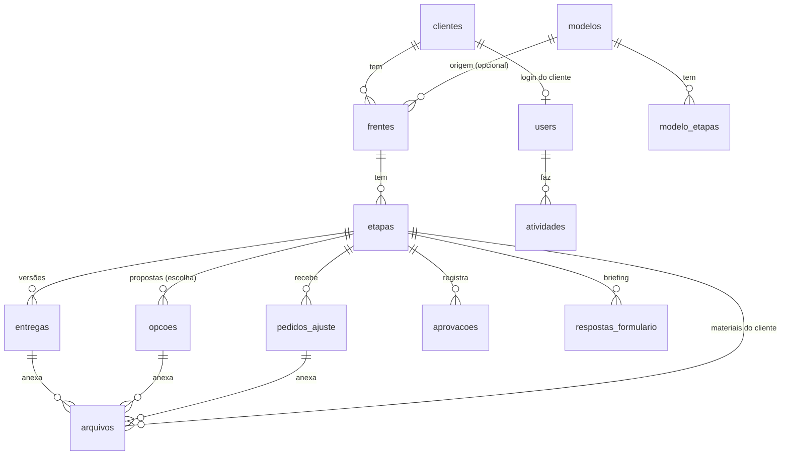

# 04 · Modelo de dados

MySQL, InnoDB, `utf8mb4`. Todas as tabelas têm `id` (bigint) e `created_at`/`updated_at`, salvo
indicação. **(cripto)** = cast `encrypted` do Laravel. **(só inserção)** = o model bloqueia update/delete.

## users
| Coluna | Tipo | Notas |
|---|---|---|
| name | string | |
| email | string, único | |
| password | string, nullable | null até o cliente criar a senha pelo convite |
| papel | enum `equipe`/`cliente` | |
| cliente_id | FK nullable | obrigatório se `papel = cliente`; único (RN-01) |
| ativo | bool, default true | RN-08 |
| two_factor_secret, two_factor_recovery_codes, two_factor_confirmed_at | Fortify | obrigatório para equipe (RN-05) |
| remember_token | | "lembrar de mim" (RN-04) |
| ultimo_acesso_em | datetime nullable | |
| boas_vindas_vistas_em | datetime nullable | C3 só no 1º acesso |

## convites
| Coluna | Tipo | Notas |
|---|---|---|
| user_id | FK | |
| token_hash | string | guarda **só o hash** do token (sha256) |
| expira_em | datetime | +72 h (RN-03) |
| usado_em | datetime nullable | |
| enviado_por | FK users | |

Reenviar acesso invalida convites anteriores do mesmo usuário.

## clientes
| Coluna | Tipo | Notas |
|---|---|---|
| empresa | string | |
| contato_nome | string | |
| email | string | e-mail de acesso (copiado para `users.email`) |
| email_avisos | string | recebe os avisos de aprovação e lembretes (RN-06); padrão = `email` |
| telefone | text (cripto) | |
| endereco | text (cripto) | |
| observacoes | text (cripto) | |
| contrato_caminho | string nullable | arquivo criptografado no disco `privado` (RN-07) |
| cor | string | cor no calendário da equipe |
| situacao | enum `ativo`/`desativado`/`arquivado` | |

## modelos e modelo_etapas
`modelos`: `nome`, `nome_cliente` (nullable, RN-16c), `slug` único, `revisoes_incluidas` (default 3), `descricao`, `ativo`.

`modelo_etapas`: `modelo_id`, `ordem`, `titulo`, `tipo` (`TipoEtapa`), `descricao_cliente` (text),
`duracao_dias_uteis` (int), `prazo_resposta_dias_uteis` (int, default 3, RN-30), `gasta_revisao` (bool),
`formulario` (string nullable, ex.: `briefing-rebranding`), `confirmar_antes_de_aprovar` (string nullable, RN-43).

Os modelos são os **fluxos padrão** dos serviços (RN-10), lidos de `dados/modelos/*.yaml` pelo
`ModelosSeeder` só para a carga inicial (os seis serviços do doc 14); depois são editados na tela
Serviços (RN-10a). `modelos` ganha `deleted_at` (desativar). `clientes`, `frentes` e `etapas` têm
`descartado_em` (datetime nullable): item excluído definitivamente da Lixeira, guardado e escondido (RN-82a). `modelo_etapas` ganha `responsavel`
(string nullable, texto livre) e `o_que_fazer` (text nullable), copiados para a fase;
`duracao_dias_uteis` passa a ser nullable.

## frentes
| Coluna | Tipo | Notas |
|---|---|---|
| cliente_id | FK | |
| modelo_id | FK nullable | null = em branco |
| nome | string | ex.: "Rebranding" |
| nome_cliente | string(100) nullable | nome que o cliente vê (RN-16c); vazio = `nome` |
| revisoes_incluidas | tinyint | padrão 3: revisões por fase (RN-71) |
| inicio_em | date nullable | opcional |
| prazo_final | date nullable | maior previsão das etapas; sem data = A combinar |
| publicada_em | datetime nullable | null = preparação privada; preenchido = acompanhamento liberado (RN-11a) |
| situacao | enum `ativa`/`concluida`/`arquivada` | |
| concluida_em | datetime nullable | RN-60 |
| arquivavel_em | date nullable | `concluida_em` + 30 dias (RN-61) |
| depende_de_frente_id | FK nullable | só informativo (RN-15) |

Revisões usadas = `pedidos_ajuste` da frente com `conta_como_revisao = true` (calculado, nunca guardado).

## etapas
| Coluna | Tipo | Notas |
|---|---|---|
| frente_id | FK | |
| ordem | smallint | |
| titulo | string | |
| tipo | enum `TipoEtapa` | legado; fora das telas da equipe desde 14/10/2026 (RN-14) |
| estado | enum `EstadoEtapa` | ver `02-fluxos.md` |
| responsavel | string nullable | texto livre: equipe, freelancer ou cliente (RN-12) |
| o_que_fazer | text nullable | RN-12 |
| entrada_em | date nullable | data de entrada (RN-12, RN-13) |
| termino_previsto_em | date nullable | previsão de término; substitui `data_prevista` |
| descricao_cliente | text nullable | o que o cliente lê |
| gasta_revisao | bool | não usado desde 14/10/2026 (modelo antigo de revisões) |
| formulario | string nullable | ex.: `briefing-rebranding` |
| confirmar_antes_de_aprovar | string nullable | RN-43 |
| oculta | bool | RN-12 |
| aviso_equipe | text nullable | aviso ao concluir trabalho da equipe |

Prazo e lembretes passam a ser do card (`entregas`). Índice: `(frente_id, ordem)`.

## entregas (cards de aprovação)
| Coluna | Tipo | Notas |
|---|---|---|
| etapa_id | FK | |
| versao | int | rodada: 1ª, 2ª, 3ª revisão, sequencial por fase (RN-71) |
| situacao | enum `SituacaoCard` | `rascunho`, `aguardando_cliente`, `aprovado`, `ajustes_solicitados` |
| nota | text | o que revisar (obrigatório para publicar) |
| links | json | lista de `{rotulo, url}`, só https |
| texto_aprovar | string(60) nullable | texto do botão de aprovação da versão final (RN-71) |
| responder_ate | date nullable | prazo: 5 dias úteis após a publicação, editável (RN-73) |
| criada_por, publicada_por | FK users nullable | |
| publicada_em | datetime nullable | null = rascunho |
| hash_conteudo | char(64) nullable | gravado ao publicar (RN-72) |
| lembrete_enviado_em | datetime nullable | RN-74 |
| alerta_vencido_em | datetime nullable | RN-75 |
| deleted_at | | exclusão suave, só de rascunho |

Arquivos via `arquivos`. Índice `(situacao, prazo_em)` para o agendador.

## opcoes
`etapa_id`, `ordem`, `titulo`, `descricao`, `recomendada` (bool), `motivo_recomendacao` (text nullable),
`entrega_id` (FK: a versão a que pertence). Arquivos via `arquivos`.

## pedidos_ajuste
| Coluna | Tipo | Notas |
|---|---|---|
| frente_id | FK | serviço do pedido |
| etapa_id, entrega_id | FK | entrega que o cliente viu |
| tipo | string | sempre `revisao` desde 14/10/2026 |
| itens | json | lista de `{texto, onde}` (`onde` opcional, RN-21) |
| numero_revisao, conta_como_revisao, correcao_nossa_*, situacao_extra | | não usados desde 14/10/2026 (modelo antigo de revisões); ficam no banco |
| enviado_por | FK users | |
| ip, navegador | string | |

## rascunhos_ajuste
`etapa_id` (único), `user_id`, `itens` (json, mesmo formato do pedido). Não conta revisão (RN-21a);
apagado ao enviar, aprovar ou publicar nova versão. Anexos do rascunho ficam em `arquivos`.

## aprovacoes (só inserção)
`etapa_id`, `entrega_id`, `opcao_id` (nullable), `user_id`, `aprovado_em`, `ip`, `navegador`,
`hash_conteudo` (sha256 de: ids e sha256 dos arquivos + link + nota da entrega). Sem `updated_at`.

## respostas_formulario
`etapa_id`, `formulario`, `respostas` (json), `rascunho` (bool), `enviado_em` (nullable).

## arquivos
| Coluna | Tipo | Notas |
|---|---|---|
| arquivavel_type, arquivavel_id | morph | entrega, opcao, pedido_ajuste, etapa (materiais) |
| nome_original | string | só para exibir; **nunca** usado como caminho |
| caminho | string | nome aleatório (uuid) no disco `privado` |
| mime | string | detectado pelo conteúdo, não pela extensão; da equipe aceita qualquer tipo (RN-50) |
| tamanho | bigint | |
| sha256 | char(64) | integridade e hash da aprovação |
| origem | enum `equipe`/`cliente` | |
| enviado_por | FK users | |

## atividades (só inserção)
`user_id` (nullable para o sistema), `cliente_id` (nullable), `frente_id` (nullable), `acao` (string,
ex.: `entrega.publicada`), `alvo_type`, `alvo_id`, `dados` (json), `ip`, `navegador`, `created_at`.

## arquivamentos
O que resta após remover (RN-63): `cliente_id` (nullable se o cliente também foi arquivado),
`empresa` (texto), `frente_nome`, `arquivado_por`, `arquivado_em`, `sha256_pacote`.

## Tabelas do framework
`sessions`, `cache`, `jobs`, `failed_jobs`, `password_reset_tokens` (padrões do Laravel).
